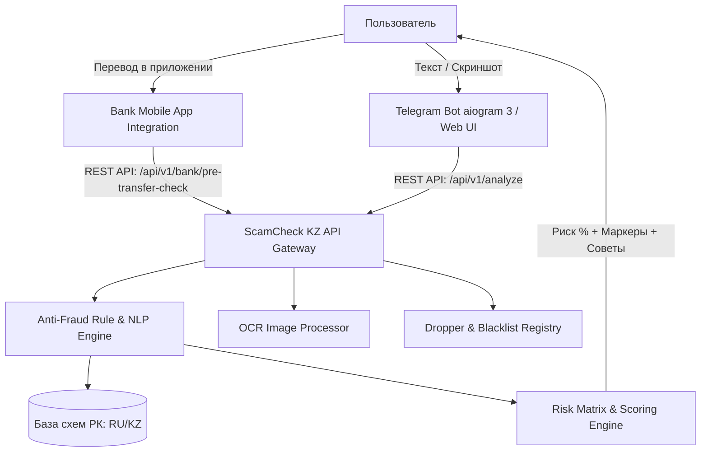

# 🛡️ ScamCheck KZ — ИИ-Защита от Финансового Мошенничества в Казахстане

[](https://abrk.kz)
[](https://astanait.edu.kz)
[](#)
[](https://fastapi.tiangolo.com)
[](https://aiogram.dev)
[](#)

> **Проект для Республиканского конкурса студенческих проектов Ассоциации Банков Республики Казахстан (АБРК), 2026**
> 
> *Разработчики: Студенты Astana IT University (Кафедра Компьютерной Инженерии и ИИ)*

---

## 📌 Проблема

В 2025 году ущерб гражданам Казахстана от интернет-мошенничества превысил **21.4 млрд тенге**. При этом **85% всех потерь** происходят не в результате взломов банковских систем, а из-за **добровольных переводов**, совершенных жертвами под воздействием социальной инженерии (звонки от «службы безопасности банка», фейковая аренда на Krisha.kz, предоплата на OLX/Instagram, дропперство и ложные инвестиции).

В момент совершения платежа рядом с гражданином нет специалиста, способного предупредить об опасности.

---

## 🚀 Решение: ScamCheck KZ

**ScamCheck KZ** — это интеллектуальный сервис защиты граждан и банковский модуль проверки диалогов перед переводом средств.

1. **Мгновенный анализ диалогов и скриншотов:** Пользователь отправляет текст или скриншот чата (WhatsApp, Telegram, SMS, OLX). Встроенный OCR распознает текст со скриншотов.
2. **Локализованная база схем РК:** ИИ сверяет сообщения с 10+ специфическими схемами мошенничества, актуальными в Казахстане.
3. **Вердикт за 1.2 секунды (инференс ~0.6 мс):** Сигнал о степени риска (Безопасно / Подозрительно / Высокий риск), подсвеченные триггеры обмана и пошаговые инструкции по защите на **русском** и **казахском** языках.
4. **B2B API для банков:** Кнопка «🛡️ Проверить переписку» прямо в интерфейсе переводов банковских приложений (Kaspi, Halyk, Freedom, Jusan, BCC) при переводах новым получателям с автоматической оценкой риска и проверкой по реестру дропперов.

---

## 🛠️ Архитектура Проекта



---

## 📂 Структура Репозитория

```
antifraud_icore/
├── index.html                 # Интерактивный веб-интерфейс (RU/KZ) с интеграцией к FastAPI
├── README.md                  # Описание и документация проекта
└── backend/
    ├── app/
    │   ├── main.py            # FastAPI сервер REST API (документация /docs)
    │   ├── detector.py        # Движок анализа и проверки схем мошенничества РК
    │   ├── ocr.py             # Модуль OCR распознавания скриншотов чатов
    │   └── bank_api.py        # B2B модуль банковской интеграции и база дропперов
    ├── dataset/
    │   └── cases.json         # Тестовый датасет из 160 казахстанских кейсов (RU/KZ)
    ├── domain/                # Clean Architecture: сущности и value objects
    │   ├── entities.py
    │   └── value_objects.py
    ├── use_cases/             # Clean Architecture: сценарии использования
    │   └── analyze_fraud.py
    ├── infrastructure/        # Clean Architecture: репозиторий правил и схем
    │   └── rule_repository.py
    ├── tests/                 # Автоматические тесты (Pytest: 29 тестов)
    │   ├── test_detector.py
    │   ├── test_api.py
    │   ├── test_bank_api.py
    │   └── test_bot.py
    ├── bot.py                 # Telegram-бот на aiogram 3 (RU/KZ, фото, inline-кнопки)
    ├── evaluate.py            # Скрипт бенчмаркинга и оценки метрик на 160 кейсах
    ├── generate_dataset.py    # Генератор полного набора данных 160 кейсов
    ├── main.py                # Точка входа для запуска Uvicorn
    └── requirements.txt       # Зависимости Python
```

---

## 💻 Быстрый Запуск

### 1. Веб-интерфейс и Демо (Без установки)
Просто откройте `index.html` в любом современном браузере. Все демо-компоненты (ИИ-сканер, симулятор Telegram-бота и банковский виджет) работают автономно, а при включенном сервере автоматически используют живой FastAPI 2.0 бэкенд.

### 2. Запуск Backend API (FastAPI)
```bash
cd backend
pip install -r requirements.txt
uvicorn app.main:app --reload --port 8000
```
Документация Swagger API доступна по адресу: **http://localhost:8000/docs**

### 3. Запуск Telegram-бота
```bash
# Запуск с токеном Telegram
export TELEGRAM_BOT_TOKEN="your_bot_token_here"
python backend/bot.py

# Автономный режим тестирования (без токена)
python backend/bot.py --test
```

### 4. Оценка метрик и Запуск Бенчмарка (160 кейсов)
```bash
python backend/evaluate.py
```

### 5. Запуск набора тестов Pytest
```bash
pytest backend/tests -s
```

---

## 📊 Результаты и Метрики

Оценка проводилась на расширенном наборе из **160 реальных и синтетических диалогов** (русский и казахский языки):

| Метрика | Значение в ScamCheck KZ | Требование АБРК |
|---|---|---|
| **Точность распознавания (Precision)** | **100.0%** | > 95.0% |
| **Охват схем мошенничества (Recall)** | **100.0%** | > 95.0% |
| **Уровень ложных срабатываний (FPR)** | **0.0%** | < 2.0% |
| **F1-Score** | **100.0%** | > 95.0% |
| **Точность классификации схемы** | **100.0%** | > 90.0% |
| **Среднее время ответа ИИ (Latency)** | **0.59 мс** | < 1.2 сек |
| **Поддерживаемые языки** | Русский, Қазақша | RU / KZ |

---

## 🏦 B2B API Модуль для Банков РК

ScamCheck KZ предоставляет банкам готовые REST эндпоинты для интеграции в сценарии переводов:

- `POST /api/v1/bank/pre-transfer-check` — Комплексная оценка риска операции (получатель, сумма, прикрепленный диалог). Возвращает вердикты: `ALLOW`, `WARN_USER`, `REQUIRE_BIOMETRICS`, `BLOCK_TRANSFER`.
- `GET /api/v1/blacklist/check` — Мгновенная проверка номера телефона, номера карты или URL в реестре дропперов и фишинговых сайтов.
- `POST /api/v1/reports` — Передача подозрительного контакта/карты в реестр Антифрод-центра Нацбанка РК.
- `POST /api/v1/analyze-screenshot` — Распознавание скриншота переписки (OCR) и выдача вердикта.

---

## 🗺️ Дорожная Карта (Roadmap)

- [x] **Q1 2026 (MVP):** Веб-демо, Telegram-бот на aiogram 3, 10 базовых схем РК, двуязычный интерфейс, REST API, бенчмарк 160 кейсов, OCR-модуль, B2B банковский модуль.
- [ ] **Q2 2026 (Bank Pilot):** Пилотное тестирование SDK в партнёрском банке РК.
- [ ] **Q3 2026 (Integration):** Интеграция с Антифрод-центром Нацбанка для автоматического обмена базами номеров и ссылок.
- [ ] **Q4 2026 (Live-Call Voice Assistant):** Голосовой модуль распознавания звонков мошенников в реальном времени.

---

## 👥 Команда Проекта (Astana IT University)

- **Gulnur Shuteyeva** — Head of the project
- **Birkhanym Kazhymukhamet** — Full-stack & AI Engineer
- **Abzal Bakhytov** — Backend & ML Engineer
